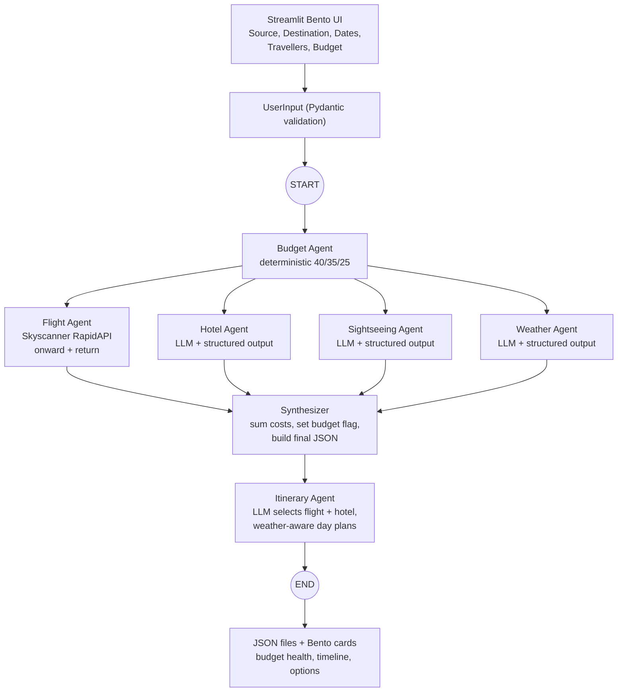

# TripPlanner.AI: Agentic AI Engineer Interview Prep

## Core Overview

This guide covers the questions an interviewer is likely to ask about **TripPlanner.AI**, a multi-agent travel planner built with **LangGraph**, **Pydantic**, **LangChain (OpenAI)** and **Streamlit**. Every answer is written in first person and grounded in the actual code, so you can say it out loud.

**How to use it**

- Questions are grouped by theme: introduction, libraries, architecture, agents and tools, LLM usage, issues faced, reliability, scaling, tough questions, and a final full-architecture walkthrough.
- No code-writing questions are included.
- Items marked **✏️ Personalize** are inferred from the code. Replace them with your real story before the interview, because interviewers can tell when an "issue faced" answer is not lived experience.
- Answers that admit a limitation are deliberate. Naming a weakness and its fix scores higher than defending a flaw.

### Project at a glance

| Item | Value |
|---|---|
| Orchestration | LangGraph `StateGraph`, compiled, with a Pydantic `GraphState` |
| Nodes | 7: budget, flight, hotel, sightseeing, weather, synthesizer, itinerary |
| Parallel stage | 4 branches (flight, hotel, sightseeing, weather) |
| LLM | OpenAI `gpt-4o-mini` (configurable through env), temperature 0.2 |
| LLM calls per run | 4 (hotel, sightseeing and weather in parallel; itinerary afterwards) |
| Real external API | Skyscanner via RapidAPI (flights only) |
| LLM-generated data | Hotels, sightseeing spots, weather |
| Budget split | 40% flights, 35% hotels, 25% sightseeing |
| UI | Streamlit, Bento Grid, 25/75 split dashboard |
| Output | `{destination}_trip.json` and `{destination}_day_wise_plan.json` |

---

## 1. Project Introduction and Motivation

### Q1. Tell me about your project (2-minute pitch).

TripPlanner.AI takes a source, destination, dates, number of travellers and a total budget, and produces a complete day-by-day trip plan. I modelled it as a LangGraph state machine. A deterministic **Budget Agent** splits the budget 40/35/25 across flights, hotels and sightseeing. Then **four agents run in parallel**: Flights (a real Skyscanner API), Hotels, Sightseeing and Weather (LLM-generated with strict Pydantic schemas). A **Synthesizer** aggregates the results, computes the actual cost and flags whether the budget was exceeded. Finally an **Itinerary Agent** uses one structured-output LLM call to pick a flight and hotel combination that fits check-in and check-out times, schedules sightseeing around the weather, and writes a narrative for each day. The UI is a Streamlit dashboard, and results are saved as JSON.

### Q2. What problem does it solve?

Trip planning means juggling flights, hotels, attractions and weather across many tabs while staying inside a budget. The project automates that by splitting the work across specialised agents and combining the results into a single feasible plan.

### Q3. Why did you build a multi-agent system instead of one big prompt?

- **Separation of concerns:** each agent has one job, one input slice and one output slice, so it is easier to debug.
- **Parallelism:** flights, hotels, sightseeing and weather are independent, so they run concurrently and latency is the slowest branch, not the sum.
- **Mixed tooling:** one agent calls a REST API, others call an LLM, others run plain Python. A single prompt cannot do that.
- **Failure isolation:** if the hotel step fails, the flights still succeed.

### Q4. Is this truly "agentic", or just a workflow?

Honestly, it is an **orchestrated multi-agent workflow** with LLM-powered nodes. The graph structure is fixed, and agents do not choose tools or loop on their own reasoning. I'd call it a *workflow-style agentic system*. The benefit is predictability, lower cost and easier debugging. The trade-off is less autonomy. The natural evolution is ReAct-style tool-calling agents with a supervisor and conditional routing (see Q55).

### Q5. What was your role?

**✏️ Personalize.** The repo is under my GitHub account. I designed the graph, state schema, agents, tools, prompts and the Streamlit UI, and I handled the debugging described in Section 6.

### Q6. Why a travel use case?

It has the properties of a good agentic problem: multiple independent data sources, a hard constraint (budget), a combination step that needs judgment (matching flight times to hotel check-in), and a user-facing structured output.

---

## 2. Tech Stack and Libraries (Situational)

| Situation | Library / approach | Why |
|---|---|---|
| Orchestrate several agents with parallel branches | **LangGraph** | Explicit state, fan-out/fan-in, supports conditional edges |
| Force the LLM to return a machine-readable shape | **Pydantic + `with_structured_output`** | Validates types and constraints (rating 0 to 5, price ≥ 0) |
| Talk to OpenAI models | **langchain-openai (`ChatOpenAI`)** | Uniform interface, structured output support |
| Call a flight REST API | **requests** | Simple, timeouts and `raise_for_status` |
| Keep API keys out of code | **python-dotenv** | Loads `.env` into environment |
| Build a quick interactive front end | **Streamlit** | No frontend code, fast to iterate |
| Validate user inputs (budget > 0, travellers > 0) | **Pydantic `Field(gt=0)`** | Fails fast with clear errors |
| Compute trip length from dates | **datetime + `computed_field`** | `num_days` derived once on the model |

### Q7. Which libraries did you use and why?

LangGraph for orchestration, LangChain with `langchain-openai` for LLM access, Pydantic for state and schema validation, `requests` for the flight API, `python-dotenv` for configuration, and Streamlit for the UI. I chose each for the smallest tool that solves the problem cleanly.

### Q8. If you need independent steps to run at the same time, which library and how?

LangGraph. I add several edges from one source node to multiple nodes. LangGraph runs them in the same superstep, which gives parallel execution without my own threading code.

### Q9. If the LLM output must be consumed by code, what do you use?

A Pydantic model plus `with_structured_output`. The LLM is steered to the schema, and the result is validated. If the response violates constraints (for example, a rating of 7), parsing fails instead of silently passing bad data downstream.

### Q10. If you have to protect secrets, what do you use?

`python-dotenv` locally, with keys kept in a `.env` file that is git-ignored. In production I'd use a secret manager (AWS Secrets Manager or GCP Secret Manager) and rotate keys. If a key was ever committed, I'd rotate it immediately.

### Q11. If you need a call to an external API to be robust, what do you use?

`requests` with an explicit **timeout** (15 s in my flight tool), `raise_for_status()` to turn bad HTTP codes into exceptions, and a try/except that returns an empty list so one failure doesn't crash the graph. I'd add `tenacity` for retries with backoff in production.

### Q12. Why both LangChain and LangGraph?

LangChain gives the model wrapper and structured output. LangGraph gives stateful, graph-shaped orchestration that LangChain chains don't. They complement each other.

### Q13. Why `gpt-4o-mini`?

It is cheap and fast, and structured output works well with it. This project makes four LLM calls per run, so cost and latency matter more than frontier reasoning. The model name is read from an environment variable, so I can swap it without code changes.

### Q14. Why Streamlit?

It let me ship a working dashboard quickly and call the compiled graph directly from Python, with no separate API layer. For production I'd put the graph behind FastAPI and keep Streamlit as a thin client.

### Q15. Which libraries would you add to make it production-ready?

- **tenacity** for retries and backoff
- **LangSmith** (or OpenTelemetry) for tracing
- **pytest** for unit and schema tests
- **Redis** for caching
- **FastAPI** to serve the graph
- A LangGraph **checkpointer** (SQLite or Postgres) for persistence

---

## 3. Architecture and LangGraph

### Q16. Explain how your graph is built.

I define a `StateGraph` over `GraphState`, register seven nodes, and wire the edges: `START → budget_agent`, then `budget_agent` fans out to flight, hotel, sightseeing and weather, then all four fan in to `synthesizer_agent`, then `itinerary_agent`, then `END`. I call `compile()` and `invoke()` it with an initial state containing the `UserInput`.

### Q17. How does fan-out / fan-in work, and how does the synthesizer know when to run?

Multiple edges leaving the budget node cause the four branches to run in the **same superstep**. All four branches have equal length, so they finish in the same step and the synthesizer then runs once with all results present. If branches had unequal lengths, I'd use LangGraph's list form of `add_edge` (a join) so the synthesizer explicitly waits for every listed branch.

### Q18. Why a Pydantic model for state instead of a TypedDict?

Pydantic validates the input at the boundary (budget > 0, travellers > 0), supports derived fields like `num_days`, and documents the data contract. Nodes read `state.user_input...` with attribute access instead of dictionary keys.

### Q19. How do parallel nodes avoid write conflicts?

Each parallel node writes to a **different state key**: flights and return_flights, hotels, sightseeing, weather_forecast. Because no two branches write the same key, I don't need reducers. If two branches had to append to the same list, I'd add an `Annotated[list, operator.add]` reducer.

### Q20. Why is the Budget Agent first, and why is it deterministic?

Every downstream agent needs its budget slice, so it must run first. Allocation is a simple fixed ratio (40/35/25), and an LLM adds cost, latency and variability without adding value. Rule of thumb: use code where the logic is deterministic and the LLM where judgment or language is required.

### Q21. Walk me through a concrete numeric example of the budget flow.

With ₹70,000 and 3 travellers, the budget agent allocates ₹28,000 to flights, ₹24,500 to hotels and ₹17,500 to sightseeing. For 15 to 19 October, that is 4 nights and 5 calendar dates. Three travellers need 1 room, so a hotel at ₹4,000 per night totals 4 × ₹4,000 = ₹16,000. The synthesizer adds the cheapest onward and return flights, the hotel total, and sightseeing entry fees × 3 travellers, and compares the sum against ₹70,000.

### Q22. Is the conditional router used?

Not in the current graph. My first design had the synthesizer route back to the budget agent when the budget was exceeded (max 2 retries), using a conditional edge. I later changed it to a **flag only** and wired the synthesizer directly to the itinerary. The router file remains as a reference. I'd rather say this openly than claim the loop is live (see Q44 for the reasoning).

### Q23. How does data flow between agents?

Through the shared `GraphState`. Each node receives the full state and returns a partial dict of only the keys it updates. LangGraph merges those updates into the state. Agents never call each other directly.

### Q24. How does the Streamlit UI interact with the graph?

The form collects source, destination, budget, travellers and dates, builds a `UserInput`, and invokes the compiled graph inside a spinner. The final state includes the itinerary and day-wise plan, which are saved as JSON and rendered as Bento cards for budget health, timeline and travel options. **✏️ Personalize** with details from your `main_1.py`.

### Q25. How would you add human-in-the-loop?

Add a LangGraph **checkpointer** and an `interrupt` before the itinerary node. When the budget is exceeded, the user could approve, raise the budget, or choose cheaper options, and the graph would resume from the saved state.

### Q26. How would you add dynamic routing or a supervisor?

Introduce a supervisor node (an LLM or rules) that decides which agents are needed. For example, skip flights for a road trip, or route to a "cheaper alternatives" agent when over budget. It would use conditional edges and loop until constraints pass or a retry cap is hit.

---

## 4. Agents and Tools Design

### Q27. Describe each agent in one line.

| Agent | Type | Responsibility |
|---|---|---|
| Budget | Deterministic | Splits total budget 40/35/25 |
| Flight | API-backed | Onward and return flights via Skyscanner, cheapest first |
| Hotel | LLM, structured output | 5 hotels with per-night price and amenities |
| Sightseeing | LLM, structured output | 10 attractions with prices, hours, transit |
| Weather | LLM, structured output | Day-wise forecast with outdoor-friendly flag |
| Synthesizer | Deterministic | Sums costs, flags budget, builds final JSON |
| Itinerary | LLM, structured output | Picks flight and hotel, builds day-by-day plan |

### Q28. Why are agents thin wrappers around tools?

Agents handle state: read inputs, pick the budget slice, catch errors, return partial state. Tools hold the logic: API call, prompt, parsing. That makes tools testable on their own (each has a standalone `__main__` run) and keeps agents simple.

### Q29. How does the flight tool work?

It reads the RapidAPI key from the environment, maps city names to IATA codes, and calls the Skyscanner endpoint once for the onward leg and once for the return (with swapped origin and destination). Each call asks for 5 results in INR, economy, for the number of adults. It converts the response into a `Flights` model, serializes it, and sorts by price.

### Q30. How do you map city names to airport codes?

An IATA dictionary keyed by uppercase city name. The lookup tries an exact match, then a partial match (the city contains the input or vice versa), and finally falls back to the first three letters of the input. The last step is a last-resort guess. In production I'd use a proper airport search API and ask the user to disambiguate.

### Q31. Why do you sort flights and hotels by price?

It makes the synthesizer's cost estimate simple: index 0 is the cheapest, giving a lower bound on total cost. The ordering has a side effect: it can bias an LLM toward the first item. I handled that explicitly in the itinerary prompt (see Q46).

### Q32. How is hotel cost calculated?

`per-night price × number of rooms × nights`. Rooms come from a small grouping function: 1 room up to 3 travellers, 2 rooms for 4, and about 2 travellers per room after that. For example, 5 travellers need 2 rooms, and 7 need 3. It is a simple heuristic that I'd make configurable (room capacity or user choice).

### Q33. How does the synthesizer compute the actual cost?

Cheapest onward flight + cheapest return flight + cheapest hotel total + (sum of sightseeing entry fees × travellers). It then compares that against the target budget and sets `budget_exceeded` plus a status of "Within Budget" or "Exceeded" in the final JSON.

### Q34. What does the cost estimate leave out?

Food, local transport, shopping and misc. expenses. The state model even has a commented-out food budget. The README mentions a Misc Agent for this, which I'd add next. The estimate is therefore a **lower bound** for the main trip components.

### Q35. Why is the weather agent LLM-generated, and how is it used?

For the project I wanted weather to influence scheduling without needing another paid API. The LLM generates a seasonal day-wise forecast for each trip date with an `is_outdoor_friendly` flag and an advisory. The itinerary agent uses it to place outdoor spots on good days and indoor spots on poor days. It is a **climate estimate, not a real forecast**, and I'd replace it with a weather API (like Open-Meteo) in production.

### Q36. How does the itinerary agent choose among multiple flights and hotels?

The prompt tells the LLM to select exactly one onward flight, one return flight and one hotel, based **only on timing**: an arrival that leaves a sensible gap before check-in, and a return departure comfortably after check-out. Price ordering is explicitly declared to carry no signal.

### Q37. How do you make sure every sightseeing spot appears in the plan?

The prompt injects the exact count of spots and requires every one to appear as a `sightseeing` event, then asks the model to count its events before finishing. It also allows more than two spots on some days, and use of Day 1 and the last day if the schedule allows, so none need to be dropped.

---

## 5. LLM Usage, Prompting and Structured Output

### Q38. How do you enforce structure in LLM outputs?

Each LLM tool defines a Pydantic response model (for example, `HotelListResponse` wraps a list of `Hotels`) and calls `with_structured_output`. Field descriptions and constraints become part of the schema the model sees, and the response is validated on return.

### Q39. Why temperature 0.2?

The tasks need consistent, schema-conforming output rather than creativity. Low temperature reduces variance across runs while still allowing natural narrative text.

### Q40. How do you handle hallucination in hotels, places and weather?

Honestly, partially. The prompts ask for real, well-known places and realistic values, and Pydantic enforces types and ranges. That prevents malformed data but **not false data**. Prices, ratings and availability can be invented. For production I'd replace these tools with real APIs (hotel, places and weather providers), and use the LLM only for planning and narration.

### Q41. What prompt design principles did you apply in the itinerary prompt?

- A clear role and a precise goal
- The full raw data embedded as JSON
- Numbered, testable rules (selection criteria, event types limited to five allowed values)
- Hard constraints with a self-check (count of spots)
- Explicit handling of edge cases (empty weather, early arrivals)
- Anti-bias instructions (price order carries no signal)

### Q42. Why does the itinerary use `method="function_calling"`?

The nested schema (a list of day plans, each with a list of events, each with an open-ended `details` dict) is complex. Function calling handled it more reliably than strict JSON-schema mode, which is picky about optional fields and defaults. **✏️ Personalize** if you remember the exact error that led you to this choice.

### Q43. How do you control the size of the prompt?

Each tool returns a bounded number of items (5 flights per leg, 5 hotels, 10 spots, one weather entry per date), so the combined JSON stays manageable. For larger trips I'd trim fields before serializing or process the plan in chunks by day.

### Q44. Why did you stop auto-retrying when the budget was exceeded?

The retry sent control back to the budget agent, but that agent is deterministic: the same input produces the same 40/35/25 split, so the downstream agents would produce nearly the same results. The loop could not actually change the outcome. A useful retry needs to change something, such as adjusting the allocation, asking the LLM for cheaper hotels, or switching flight options. So I made it a flag for now. **✏️ Personalize** if your reasoning was different.

### Q45. What are the prompt-injection risks?

User-supplied strings (source, destination) are interpolated directly into prompts, so a malicious destination like "ignore previous instructions…" could steer the model. Mitigations: validate destinations against a known list or geocoder, keep user text out of system-level instructions, and validate every output against the schema.

### Q46. What bias did you notice in the LLM's selection, and what did you do?

Lists sorted by price invite the model to pick the first item regardless of fit. I added an explicit instruction that ordering is a data convenience and that selection must follow the timing criteria only. **✏️ Personalize** if you saw this during testing.

---

## 6. Issues Faced and How I Resolved Them

> **✏️ Personalize all of Section 6.** These answers are reconstructed from decisions visible in the code. Keep the ones that match your memory and replace the details with your real debugging story.

### Q47. What was the hardest issue you faced?

Getting reliable structured output from the itinerary LLM. The output is deeply nested (days, events, details), and early runs could drop sightseeing spots or break the schema. I fixed it with function-calling mode, tighter schema descriptions, a numbered rule list, and a count-and-verify instruction in the prompt.

### Q48. The LLM skipped some sightseeing spots. How did you fix it?

I injected the exact number of spots into the prompt, required each one to appear as an event, added a self-count step, and relaxed the "two spots per day" preference so there was always room for all of them.

### Q49. The LLM always picked the cheapest flight. What did you do?

I added a rule that price order is meaningless for selection, then defined selection criteria around check-in and check-out timing and flight arrival and departure times.

### Q50. Your budget retry didn't improve anything. What was the issue?

Retrying a deterministic budget step with the same inputs gives the same output. The retry counter was also never incremented, so the loop would not have terminated cleanly. I simplified to a flag and documented what a meaningful retry would need to change.

### Q51. How did you handle API failures and missing keys?

Every tool catches exceptions and returns an empty list. Every agent also wraps the tool call in try/except and logs a warning. If the RapidAPI key is missing, the flight tool returns empty onward and return lists. The graph continues instead of crashing.

### Q52. What problem did you hit when running agents in parallel?

Concurrent writes to shared state. I avoided it by making each branch write to its own key, so no reducer is needed.

### Q53. Did you face date-handling issues?

Yes. A same-day trip would give zero nights, so I clamp the trip length to at least 1 with `max(..., 1)`. The weather tool enumerates **every calendar date inclusively** (4 nights means 5 dates), so each itinerary day has a weather entry.

### Q54. Your README and code differ. How did that happen, and how do you manage it?

The README describes the first design (retry loop, Misc Agent), and the code evolved (flag only, Weather Agent). I'd update the README to match the code, keep the old design in a "future work" section, and add an architecture diagram generated from the compiled graph so docs can't drift.

---

## 7. Reliability, Testing, Security and Observability

### Q55. What is your overall error-handling strategy?

**Graceful degradation.** Each node catches its own exceptions and returns an empty result, so one failing branch doesn't kill the run. The downside is that a failure can be silent. In production I'd surface a clear "flights unavailable" message in the UI and log structured errors.

### Q56. How did you test it?

**✏️ Personalize.** Each tool has a standalone `__main__` run for manual testing, and `workflow.py` has a full-graph run with a sample input (Delhi to Varanasi, ₹70,000, 3 travellers). Next I'd add automated tests: schema tests with mocked LLM responses, unit tests for cost and room calculations, and API mocks for the flight tool.

### Q57. How would you evaluate the quality of the itinerary?

I'd build an eval set of varied trips and check:

- **Deterministic checks:** schema validity, all spots present, day 1 has arrival and check-in, last day has check-out and departure, dates sequential.
- **Constraint checks:** cost vs budget, rain days without outdoor spots.
- **LLM-as-judge:** coherence, realism of timing, narrative quality.
- **Tracked over time:** pass-rate per check across prompt or model changes.

### Q58. How would you add observability?

Trace each run with LangSmith or OpenTelemetry: node latency, token usage, errors, and the inputs and outputs of each LLM call. Replace `print` statements with structured logs keyed by a run ID.

### Q59. How do you handle secrets and security?

Keys come from environment variables, `.env` is git-ignored, and keys are never logged. If a key was ever exposed, I rotate it. I'd also validate user input, rate-limit the endpoint, and apply the prompt-injection mitigations from Q45.

### Q60. What about user data and privacy?

The app handles only trip details (cities, dates, budget). It stores no personal identifiers. If I added accounts, I'd store the minimum, encrypt at rest, and offer deletion.

---

## 8. Scaling, Cost, Latency and Roadmap

### Q61. What is the latency profile?

Latency is the slowest parallel branch plus the itinerary call. The flight branch makes two sequential API calls, and the other three branches each make one LLM call. The itinerary call is the largest, so it dominates. (Measure your own numbers: a typical run might be on the order of tens of seconds.)

### Q62. How would you reduce latency?

- Run the onward and return flight calls concurrently
- Stream the itinerary day by day
- Cache sightseeing and weather by destination and month
- Use a smaller model for simple extraction and keep the larger one for planning

### Q63. What does a run cost?

Four LLM calls on a small model. The itinerary call is the heaviest because it includes all raw data plus a long instruction block. Check your provider dashboard for exact numbers. Caching by destination would remove most repeat cost.

### Q64. How would you scale it to many concurrent users?

Serve the graph behind FastAPI with async execution, run workers behind a queue, add a Redis cache for destination-level data, set per-user rate limits, and persist state with a checkpointer. Because the graph holds no global state, workers scale horizontally.

### Q65. Which parts would you replace with real data sources?

Hotels (Booking or Amadeus), sightseeing (Google Places), and weather (a forecast API). The LLM would then plan and narrate over real data, which removes most hallucination risk.

### Q66. What is on your roadmap?

- A smart retry or negotiation loop when over budget (cheaper hotel, alternate dates)
- A Misc Agent for food, local transport and packing
- Real hotel, places and weather APIs
- Evals and tracing
- Human-in-the-loop approval and persistence
- Voice input (listed in the README)

---

## 9. Tough and Honest Questions

### Q67. What are the weaknesses of your system?

1. **Hotels, sightseeing and weather are LLM-generated**, so prices and availability are not verified.
2. **Budget is checked on the cheapest options**, but the itinerary may select a different flight or hotel, so the reported cost can differ from the final plan.
3. **Silent failure paths** return empty lists without clear user messaging.
4. **No automated tests or evals** yet.
5. **README and code drift** on the retry loop and the Misc Agent.

### Q68. Why didn't you use a ReAct agent with tool calling?

The flow is well-defined and the budget matters, so a fixed graph is cheaper, faster and more predictable. A ReAct agent adds flexibility, but also variable cost, loops and harder debugging. I'd use one for the "negotiate a cheaper plan" loop, where the decisions are open-ended.

### Q69. If the itinerary selects a different hotel than the cheapest, isn't your budget check wrong?

Yes, it is a known inconsistency. The fix is to compute the cost **after** the itinerary agent selects the final options, or to have the itinerary return the selected IDs and let the synthesizer re-price them.

### Q70. Is there any mismatch between your prompt and your schema?

Yes. The itinerary prompt asks the model to copy the weather entry into a per-day `weather` field, but the `DayPlan` model doesn't define one, so that data is not captured in the structured output. The fix is to add an optional weather field to `DayPlan`. The narrative still references the weather, so the user sees the effect, but the structured data does not carry it.

### Q71. If you could redo it, what would you change first?

I'd (1) swap in real APIs for hotels, places and weather, (2) move the budget check after final selection with a real retry that changes something, (3) add evals and tracing from day one, and (4) keep the docs generated from the graph.

### Q72. What did you learn from building it?

Structured output and prompt constraints matter more than model size. Parallel graphs are easy to build if state keys are disjoint. And honest limits (what's mocked and what's real) must be documented early.

---

## 10. Complete Architecture Walkthrough

### Q73. Explain the complete architecture of the system.

**Say it in this order: Inputs, State, Orchestration, Agents, Synthesis, Output, UI, Limits.**

**Spoken walkthrough**

1. **Input and validation.** The user fills the Streamlit form. Values are validated by a Pydantic `UserInput` (positive budget, positive travellers, ISO dates, derived `num_days`). This becomes part of the shared `GraphState`.

2. **State.** `GraphState` is the single source of truth: user input, budget allocation, flights, return flights, hotels, sightseeing, weather forecast, the day-wise plan, a retry counter, a budget-exceeded flag and the final itinerary. Nodes return only the keys they change.

3. **Budget Agent (entry).** Splits the total into flights 40%, hotels 35%, sightseeing 25%. Example: ₹70,000 becomes ₹28,000 / ₹24,500 / ₹17,500.

4. **Parallel stage (fan-out).** Four independent agents run in the same superstep:
   - **Flights:** the only real API. IATA mapping, two calls (onward and return), 5 options each, sorted by price.
   - **Hotels:** LLM returns 5 hotels through a strict schema. The code computes room count and total cost.
   - **Sightseeing:** LLM returns 10 attractions with entry prices, hours and transit.
   - **Weather:** LLM returns a day-wise seasonal forecast with an outdoor-friendly flag.

   Each writes to its own state key, so there are no conflicts.

5. **Synthesizer (fan-in).** Waits for all branches, adds the cheapest flights, hotel total and sightseeing fees × travellers, compares against the target, sets the budget flag and builds the final JSON structure.

6. **Itinerary Agent.** One structured-output LLM call. It selects one onward flight, one return flight and one hotel based on timing, then spreads every sightseeing spot across days, using weather to decide outdoor versus indoor days, and writes a short narrative per day.

7. **Output and UI.** The result is saved as `{destination}_trip.json` and `{destination}_day_wise_plan.json`, and the Streamlit dashboard renders budget health, timeline and travel options.

8. **Reliability and limits.** Every node degrades gracefully (empty results on failure). Known limits: three data sources are LLM-generated, the budget check uses the cheapest options, there are no evals yet, and the retry loop was replaced by a flag.

9. **Evolution.** Real APIs for hotels, places and weather; a post-selection budget check with a meaningful retry or human approval; a supervisor with conditional routing; checkpointing; tracing and evals.

---

## Summary: Three Takeaways

1. **Know your architecture cold.** Budget first, a four-way parallel stage with disjoint state keys, a synthesizer join, then one structured-output itinerary call. Explain *why* each piece exists.
2. **Be honest about what is real and what is generated.** Only flights use a live API. Naming that, and the fix, builds more trust than overclaiming.
3. **Turn every weakness into a roadmap item.** Retry-loop mismatch, budget-versus-selection inconsistency, the missing `weather` schema field and the missing evals are all concrete improvements that show engineering judgment.
