# Amazon Bedrock AgentCore: The Production Layer for AI Agents

## Core Overview

Building an agent that works in a notebook is the easy 20%. The other 80% is everything around it: where the code runs, how it stays isolated from other users, what it remembers, how it calls tools safely, whose permissions it uses, how you see what it did, and how you stop it doing something it shouldn't.

**Amazon Bedrock AgentCore** is AWS's answer to that 80%. It is a set of **modular services** for building, deploying, and operating agents securely at scale, using **any framework** (LangGraph, CrewAI, LlamaIndex, Strands Agents, Google ADK, OpenAI Agents SDK) and **any model**, inside or outside Amazon Bedrock. If Bedrock is the model layer, AgentCore is the **production layer around the agent**.

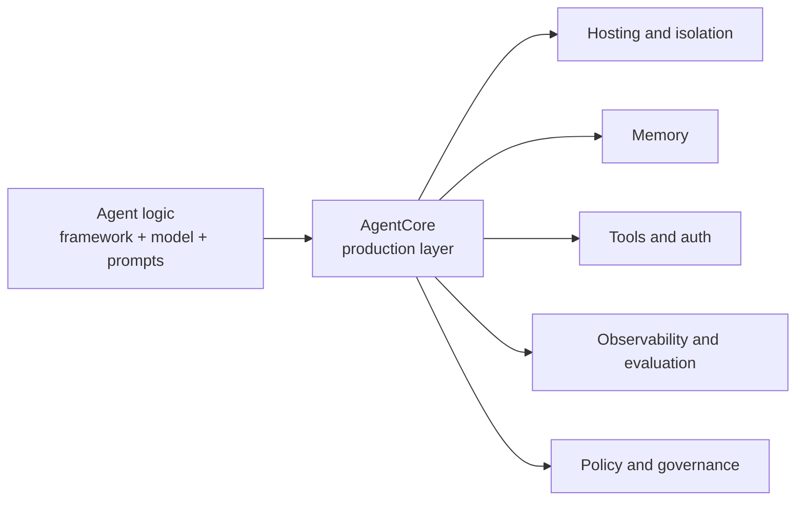

The key design idea is **composability**: every service can be adopted on its own or together with the others. You can run your agent on Runtime and keep your own memory store, or use only Gateway to expose APIs as MCP tools to an agent hosted somewhere else entirely.

---

## 1. Why AgentCore Exists

### A. The Prototype-to-Production Gap

A prototype agent is typically one Python process with a model call, a list of tools, and a chat history in a variable. Production breaks every one of those assumptions:

| Prototype assumption | What breaks in production | AgentCore service |
|---|---|---|
| One user at a time | Concurrent users must not see each other's data | **Runtime** (one microVM per session) |
| History lives in a Python variable | Process restarts, users return days later | **Memory** |
| Tools are hard-coded functions | Dozens of enterprise APIs, each with its own auth | **Gateway** |
| One API key in an env var | Agents must act as a specific user with scoped access | **Identity** |
| `print()` debugging | Need step-level traces of reasoning and tool calls | **Observability** |
| "Looks good to me" testing | Quality must be measured before and after deploy | **Evaluations** |
| Trust the prompt to behave | Hard business rules must be enforced deterministically | **Policy** |

### B. AgentCore vs. Amazon Bedrock Agents

These are often confused, and they are different products.

| | **Amazon Bedrock Agents** | **Amazon Bedrock AgentCore** |
|---|---|---|
| Approach | Configuration-driven, low-code | Infrastructure platform for **custom-built** agents |
| Framework | Bedrock's own orchestration model | **Any** framework |
| Model | Bedrock models | Any model, in or out of Bedrock |
| You write | Configuration | Agent code (or use **Harness**, see 2.F) |
| Best for | Fast, standard agents inside Bedrock | Production agents needing custom logic, isolation, and governance |

### C. The Service Map

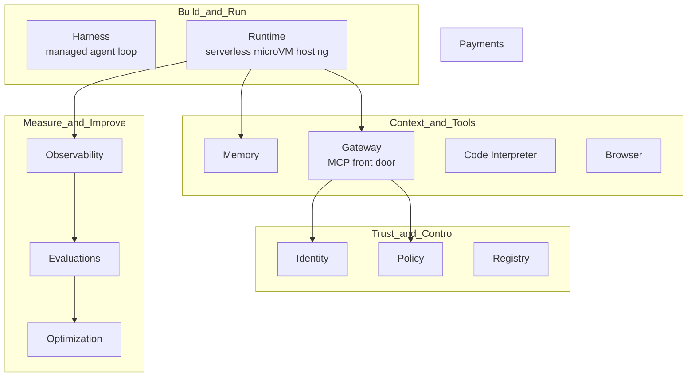

| Service | One-line job |
|---|---|
| **Harness** | Managed agent loop: define model, system prompt, and tools in a single API call |
| **Runtime** | Secure serverless hosting with true per-session isolation |
| **Memory** | Short-term (within a session) and long-term (across sessions) memory |
| **Gateway** | Turns APIs, Lambda functions, and MCP servers into agent-usable MCP tools |
| **Identity** | Agent and user identity, plus a vault for outbound credentials |
| **Code Interpreter** | Sandboxed code execution (Python, JavaScript, TypeScript) |
| **Browser** | Managed cloud browser for agents to operate web apps |
| **Observability** | Step-level tracing, debugging, and monitoring via OpenTelemetry and CloudWatch |
| **Evaluations** | Automated quality scoring of sessions, traces, and spans |
| **Optimization** | AI-generated improvement recommendations validated by A/B tests |
| **Policy** | Deterministic rules that intercept tool calls before they run |
| **Registry** | Central catalog of agents, MCP servers, tools, and skills |
| **Payments** | Microtransaction payments for agents using the x402 and MPP protocols |

The sections below go through each in the order you would typically adopt them.

---

## 2. AgentCore Runtime

### A. The Core Idea: One Session, One microVM

Runtime is where your agent (or MCP server) code actually runs. Its defining property is **session isolation**: every session gets its **own dedicated microVM** with isolated compute, memory, and filesystem. When the session ends, the microVM is terminated and its memory is **sanitized**, so one user's data cannot leak into another's.

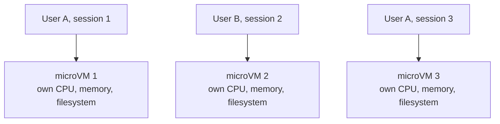

Requests that carry the **same session ID** are routed to the **same microVM**, so in-memory state survives between turns of one conversation, but only for the life of that compute.

### B. Session Lifecycle and the Numbers That Matter

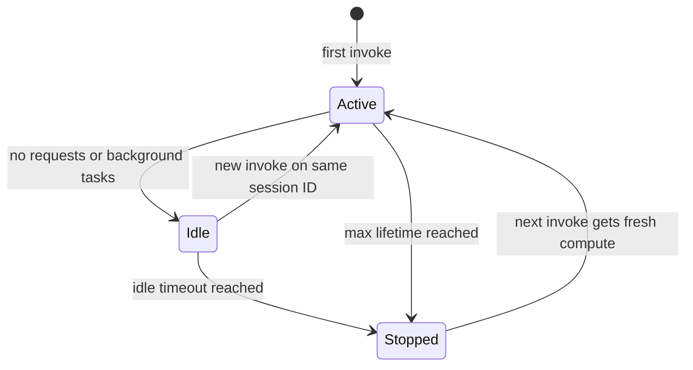

| Setting | Value |
|---|---|
| Idle timeout (`idleRuntimeSessionTimeout`) | Default **15 minutes**, configurable |
| Max lifetime (`maxLifetime`) | Up to **8 hours** per microVM lifecycle; AWS documents up to **14 days** on Instances |
| Request payload | Up to **100 MB** |
| Session ID length | At least **33 characters** |
| Stop a session early | `StopRuntimeSession` terminates the microVM immediately |

Two consequences follow from this model:

- **Ephemeral compute.** Anything held only in process memory or local disk is lost when the microVM stops. Durable facts belong in **Memory**; files that must survive stop/resume can use session storage (listed as public preview in AWS material at the time of writing).
- **The session ID outlives the compute.** After a stop, the same session ID is still valid. The next call provisions **fresh compute** with a new lifecycle clock (another full 8 hours at most), but with no in-process state.

For long-running work, Runtime keeps a session alive while a background task is registered; the health check reports a busy state instead of idle, so an agent finishing a 40-minute job is not reaped at the 15-minute mark.

### C. Protocols, Frameworks, and Models

| Dimension | Supported |
|---|---|
| **Frameworks** | Custom code, LangGraph, CrewAI, LlamaIndex, Strands Agents, Google ADK, OpenAI Agents SDK |
| **Models** | Any, including Claude, Amazon Nova, OpenAI, Gemini, Llama, Mistral |
| **Protocols** | HTTP, **MCP**, **A2A** (and AG-UI) |
| **Session header** | `Mcp-Session-Id` for MCP; `X-Amzn-Bedrock-AgentCore-Runtime-Session-Id` for HTTP, A2A, AG-UI |

### D. Deploying an Agent

The Python SDK wraps your agent in a small app with a single entrypoint:

```python
from bedrock_agentcore.runtime import BedrockAgentCoreApp
from strands import Agent

app = BedrockAgentCoreApp()
agent = Agent()                      # any framework works here

@app.entrypoint
def invoke(payload, context):
    prompt = payload.get("prompt", "")
    result = agent(prompt)
    return {"result": str(result)}

if __name__ == "__main__":
    app.run()
```

The `@aws/agentcore` CLI is now the recommended way to create, develop, and deploy (it supersedes the older Python starter toolkit):

```bash
agentcore create --name MyAgentProject
cd MyAgentProject
agentcore deploy
agentcore invoke
```

### E. The Gotcha: Runtime Does Not Map Users to Sessions

AgentCore isolates the **microVM**, but it does **not** enforce which user owns which session ID. If your backend lets a client send any session ID, user B could resume user A's session.

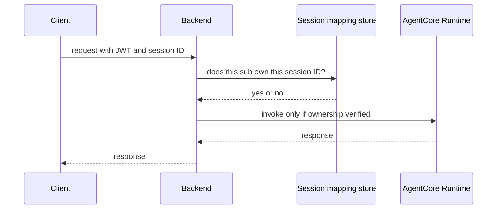

Keep a persistent `sub -> sessionId` table in your backend. It must outlive the compute, because the microVM stops after about 15 minutes idle but the session ID stays valid.

### F. Harness: The Agent Loop as a Service

If you do not want to write the loop yourself, **Harness** is a managed agent loop: you specify a **model**, a **system prompt**, and **tools** in a single API call, and it handles orchestration, tool execution, memory management, and response generation. Each session runs in an isolated microVM with filesystem and shell access, which suits code generation, data analysis, and deep research. It works with Amazon Bedrock, OpenAI, Google Gemini, and any OpenAI-compatible model provider, and supports remote MCP servers and bring-your-own container images.

---

## 3. AgentCore Memory

### A. Two Tiers of Memory

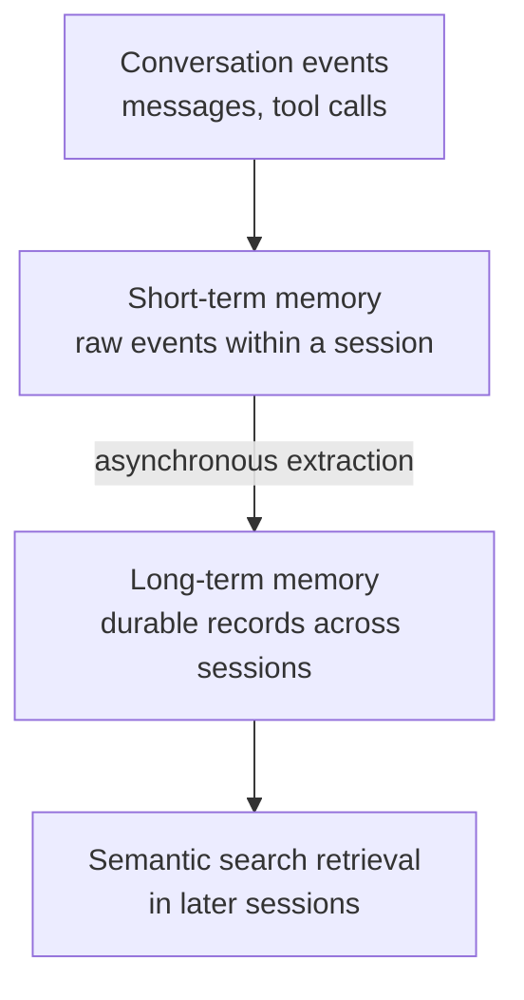

| Tier | Holds | Lifetime | Used for |
|---|---|---|---|
| **Short-term** | Raw events (messages, tool calls), scoped by `actorId` + `sessionId` | Until event expiry | Continuity across turns |
| **Long-term** | Distilled records extracted by strategies | Until TTL or deletion | Personalization across sessions |

### B. The Four Built-In Long-Term Strategies

| Strategy | Captures | Example record |
|---|---|---|
| **Semantic** | Factual knowledge | "The customer's company has 500 employees" |
| **Summary** | Running summaries, scoped by actor and session | "Reviewed auth options, chose OAuth 2.0" |
| **User preference** | Choices and styles, as structured data | "Prefers Python for development work" |
| **Episodic** | Significant events as discrete episodes, with **reflection** across episodes | "Resolved a billing dispute by escalating to Tier 2" |

You can also define **custom strategies**, overriding the extraction and consolidation prompts and the model used, or run **self-managed** strategies where you own the processing.

Each strategy runs in steps: **extraction** (pull candidates from events), **consolidation** (merge with existing records so you do not store 40 copies of the same fact), and, for episodic memory only, **reflection** (generate insights across episodes).

### C. Namespaces: Where Memories Live and Who Can See Them

**Namespaces** are hierarchical, path-like keys that organize long-term records, enable scoped retrieval, and support access control. Templates use placeholders such as `{actorId}` and `{sessionId}`.

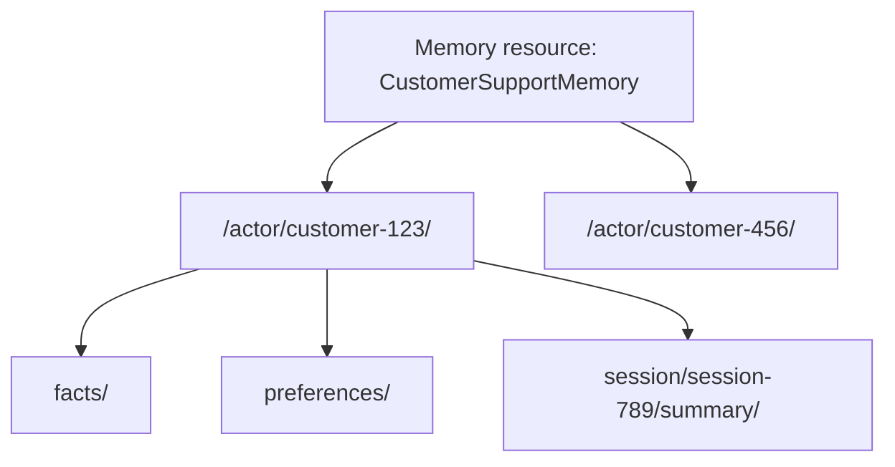

A template such as `/actor/{actorId}/facts/` resolves per user, so retrieval for one customer **never searches another customer's records**. Design the namespace by access pattern: semantic and preference memory are typically **actor-scoped** (follow the user everywhere), while summaries and episodes are typically **session-scoped**.

### D. Creating a Memory Resource

```python
import boto3

control = boto3.client("bedrock-agentcore-control")

memory = control.create_memory(
    name="CustomerSupportMemory",
    eventExpiryDuration=30,                      # days short-term events are kept
    memoryStrategies=[
        {"semanticMemoryStrategy": {
            "name": "Facts",
            "namespaces": ["/actor/{actorId}/facts/"]}},
        {"summaryMemoryStrategy": {
            "name": "SessionSummaries",
            "namespaces": ["/actor/{actorId}/session/{sessionId}/summary/"]}},
        {"userPreferenceMemoryStrategy": {
            "name": "Preferences",
            "namespaces": ["/actor/{actorId}/preferences/"]}},
    ],
)
```

The exact field name for the namespace list (`namespaces` vs. `namespaceTemplates`) has varied across SDK versions, so check the version you have installed.

### E. Two Operational Realities

- **Extraction is asynchronous.** A fact the user states in turn 3 will not be retrievable instantly. One third-party test measured semantic and preference records becoming retrievable about **82 seconds** after the conversation ended, and episodic records about **16 minutes**. Do not design a flow that expects to read back what was just written.
- **Retention is a design decision.** A reasonable starting policy: summaries expire after **30-60 days**, semantic facts after **6-12 months**, and consider **no TTL** for procedural knowledge such as reflections. By use case: a real-time support bot about **7 days**, a sales or onboarding agent about **21 days**, a general assistant about **45 days**.

---

## 4. AgentCore Gateway

### A. A Managed MCP Front Door

Agents need tools, and enterprises already have hundreds of APIs. **Gateway** converts existing APIs, Lambda functions, and services into **MCP-compatible tools**, and also connects to pre-existing MCP servers, exposing all of them through a single endpoint.

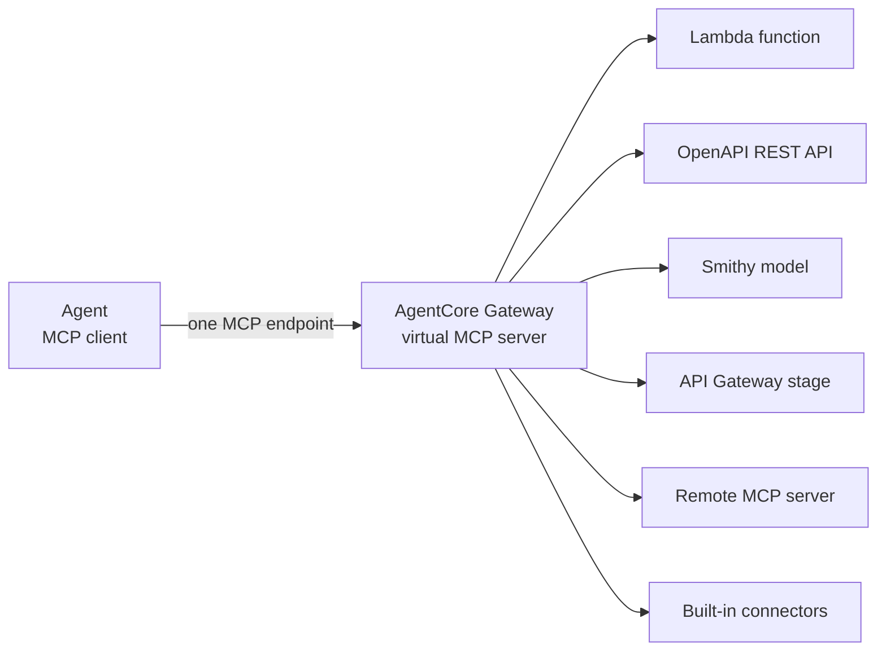

| Target type | What it gives you |
|---|---|
| **Lambda function** | Custom business logic in any language, mapped to MCP tools |
| **OpenAPI schema** | An existing REST API turned into tools with no code |
| **Smithy model** | Tools for AWS services or Smithy-defined APIs |
| **API Gateway stage** | Point directly at a stage without exporting an OpenAPI spec |
| **Remote MCP server** | Its tools, prompts, and resources, re-exposed centrally |
| **Connectors** | Pre-built integrations such as Salesforce, Slack, Jira, and an AWS-run web search |

MCP is Gateway's only protocol, and each tool is addressed as `target___tool`.

### B. Semantic Tool Search

Give a model 300 tools and two things go wrong: the tool list eats the **context window**, and the model picks the wrong tool more often. Gateway provides a built-in search tool, `x_amz_bedrock_agentcore_search`, so the agent first asks "which tools fit this task?" and receives a short relevant list, instead of loading everything.

### C. Two-Sided Security

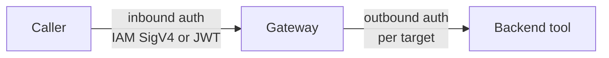

| Direction | Options |
|---|---|
| **Inbound** (caller to Gateway) | `CUSTOM_JWT` (your IdP), `AWS_IAM` (SigV4), `AUTHENTICATE_ONLY` (validate the token, leave authorization to a policy engine), `NONE` |
| **Outbound** (Gateway to backend) | Gateway IAM role (Lambda, Smithy, API Gateway), or an **AgentCore credential provider** holding an API key or OAuth credentials (OpenAPI and MCP targets) |

Each target is associated with exactly **one** outbound auth configuration, which keeps audit trails clean.

### D. Pricing Shape

Gateway has been priced at **$0.005 per 1,000 tool invocations**, **$0.025 per 1,000 search calls**, and **$0.02 per 100 tools indexed per month** (launch-era published figures). Per-call cost is tiny, but a busy agent adds up: **200 million** tool calls a month is about **$1,000** in invocation charges.

---

## 5. AgentCore Identity

### A. The Problem: Agents Are Non-Human Identities

An agent often needs to act **as a specific user** against third-party systems (Slack, GitHub, Salesforce). The naive solution, storing that user's token inside the agent, means a prompt injection that exfiltrates the context leaks a long-lived secret.

**Identity** is built for non-human workloads and has three jobs: **inbound authentication** (who is calling the agent), **workload identity** (the agent's own identity), and a **token vault** for **outbound** credentials so the agent never holds a refresh token or client secret.

### B. The Three Hops

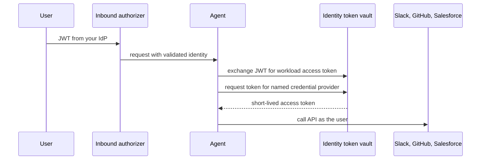

Outbound tokens come in three flows:

| Flow | Use when |
|---|---|
| **USER_FEDERATION** | The agent acts as one user; the user consents once through an authorization-code flow and the token is stored per user |
| **M2M** | Machine-to-machine client credentials, shared across users |
| **ON_BEHALF_OF_TOKEN_EXCHANGE** | Exchange the caller's token for a downstream token, preserving user identity |

Identity works with existing providers (**Amazon Cognito, Okta, Microsoft Entra ID, Auth0**), so there is no user migration. Used **through Runtime or Gateway it carries no additional charge**; used standalone it has been priced at about **$0.010 per 1,000** token or API-key requests.

---

## 6. Code Interpreter and Browser

### A. Code Interpreter

A sandboxed environment where the agent can **write and run code** (Python, JavaScript, TypeScript). This lifts accuracy on tasks models are weak at doing "in their head": arithmetic over a 5,000-row table is far more reliable as `df.groupby(...)` than as generated prose.

### B. Browser

A managed, cloud-based browser runtime that lets agents navigate sites, fill forms, and extract information, driven through frameworks like **Playwright** or **BrowserUse** and any foundation model.

### C. Session Hygiene

Both use a **session model** (start, use, stop) with a session timeout up to **8 hours** and a default idle timeout around **15 minutes**. A forgotten session lingers until its idle timeout, so **stop sessions explicitly** when a task finishes, and shorten the idle timeout for short tasks.

---

## 7. Observability, Evaluations, and Optimization

### A. Observability: See Every Step

Agents fail in ways that logs of inputs and outputs cannot explain: a wrong tool picked, a bad argument, a retrieved document that was irrelevant. **Observability** gives step-by-step visualizations of the agent's workflow so you can inspect the execution path, audit intermediate results, and find bottlenecks. Telemetry is emitted in standard **OpenTelemetry** format, so it plugs into existing monitoring stacks, and AWS surfaces it through **Amazon CloudWatch** (metrics land in the `Bedrock-AgentCore` namespace).

### B. Evaluations: Measure Quality

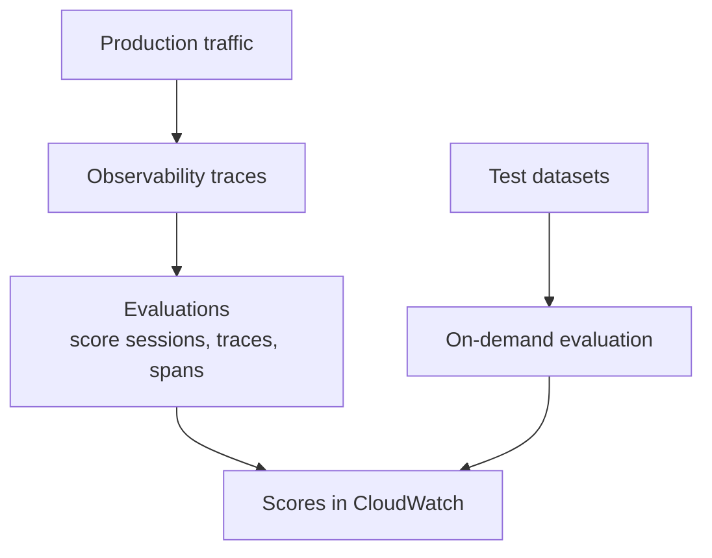

Evaluations supports **online evaluation** of live production traffic and **on-demand evaluation** for testing workflows, over **sessions, traces, and spans** from Strands Agents or LangGraph agents instrumented with OpenTelemetry or OpenInference. This is the managed counterpart to the offline/online eval pipelines discussed for LLM applications generally: a golden-dataset run before release, and continuous scoring after.

### C. Optimization: Close the Loop

Optimization builds on Evaluations: it analyzes agent traces, generates **AI-recommended changes** (to the system prompt and tool descriptions), packages them as **versioned configuration bundles**, and validates them with **A/B tests** using Gateway traffic splitting, rather than guesswork. It is a newer capability, so confirm its current availability and pricing before depending on it.

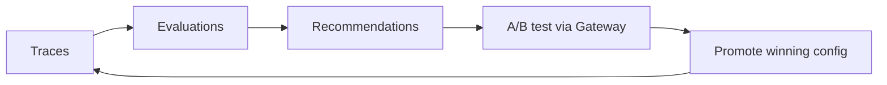

---

## 8. Policy, Registry, and Payments

### A. Policy: Deterministic Rules for Non-Deterministic Agents

Prompts are suggestions; a model can be talked out of them. **Policy** provides **deterministic** enforcement: it integrates with **Gateway** to intercept **every tool call before execution** and allow or deny it based on rules about which tools an agent may use, which actions it may take, and under what conditions. Rules can be written in natural language or in a Cedar-compatible policy language.

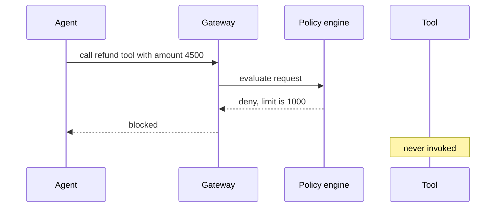

For example, a rule "refunds above **$1,000** require approval" is enforced outside the model entirely, so no prompt injection can override it. This is the **behavior and task guardrail** category (tool-use restrictions, action validation) from the general guardrails taxonomy, implemented at the tool boundary.

### B. Registry: A Catalog for the Organization

A centralized catalog to discover and manage **agents, MCP servers, tools, skills, and custom resources**, with a controlled **publish, review, approve** workflow and hybrid semantic plus keyword search. It works with resources deployed on AWS, on-premises, or in other clouds, and it prevents ten teams from building the same Salesforce tool ten times.

### C. Payments: Agents That Pay

A managed service for **microtransaction payments** so agents can access paid APIs, MCP servers, and content using the **x402** protocol and the **Machine Payments Protocol (MPP)**, with wallet integration (Coinbase CDP, Stripe via Privy), **configurable spending limits**, and end-to-end observability. This is a newer, more specialized capability.

---

## 9. Putting It Together

### A. A Request Through the Full Stack

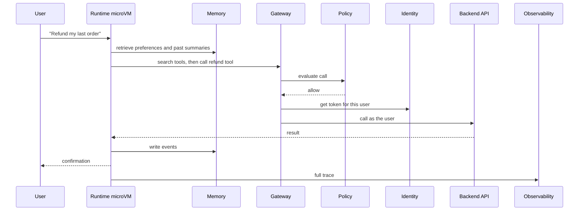

### B. Worked Cost Example

Illustrative only: these use **launch-era published rates** (Runtime **$0.0895 per vCPU-hour** and **$0.00945 per GB-hour**, Gateway **$0.005 per 1,000** invocations, short-term memory **$0.25 per 1,000** events). AWS has since introduced a second Runtime pricing generation with different rates and has announced changes to short-term memory pricing, so verify against the current pricing page before budgeting.

**Scenario:** a support agent handling **100,000 sessions a month**. Each session lasts **60 seconds** but the agent spends 70% of that waiting on the model, so active CPU time is **18 seconds** at 1 vCPU, with **2.5 GB** peak memory, **5 tool calls**, and **4 memory events**.

| Component | Calculation | Monthly cost |
|---|---|---|
| Runtime CPU | 18 s = 0.005 vCPU-hr x $0.0895 = $0.0004475 per session x 100,000 | **$44.75** |
| Runtime memory | 60 s x 2.5 GB = 0.0417 GB-hr x $0.00945 = $0.000394 per session x 100,000 | **$39.38** |
| Gateway | 500,000 invocations x $0.005 / 1,000 | **$2.50** |
| Short-term memory | 400,000 events x $0.25 / 1,000 | **$100.00** |
| **Total (excluding model tokens)** | | **about $187, or roughly $0.0019 per session** |

Three lessons from the arithmetic:

- **CPU is billed on active use, not wall-clock time.** Waiting on the model is cheap, which is why agent workloads suit this billing model.
- **Memory (the service) can outweigh compute.** In this example, storing events costs more than all the Runtime compute combined.
- **Model tokens will dwarf all of it** for most agents. The platform bill is usually the smaller line; per-agent cost attribution via Bedrock application inference profiles matters more.

### C. When to Use AgentCore

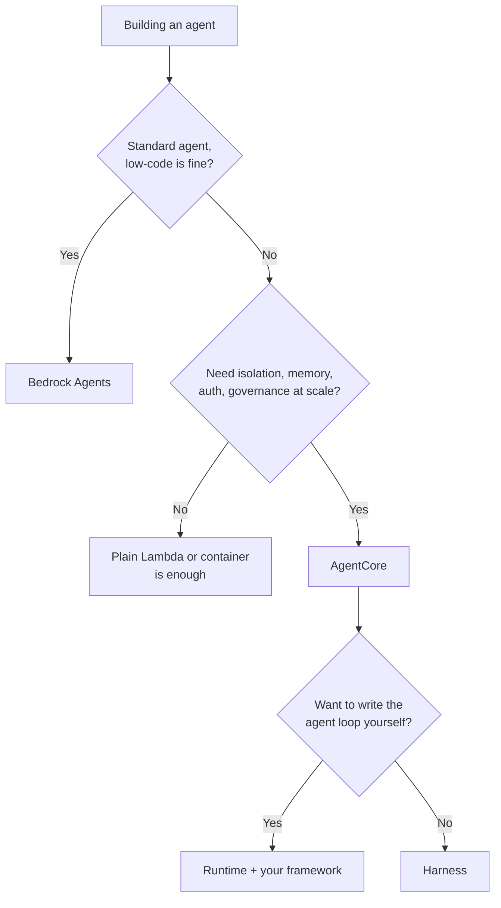

### D. Limits and Caveats to Plan For

| Caveat | Why it matters |
|---|---|
| **8-hour microVM lifetime** | Jobs longer than that must checkpoint and resume, or use Instances |
| **Session-to-user mapping is yours** | Skipping it is a cross-user data exposure risk |
| **Memory extraction is async** | Do not read back what was just written |
| **Pricing is in flux** | Two Runtime generations and memory pricing changes; recheck before budgeting |
| **AWS coupling** | Open protocols (MCP, A2A, OpenTelemetry) reduce lock-in, but Identity, Policy, and Memory are AWS services |
| **Newer services** | Optimization, Registry, and Payments are recent; check regional availability and status |

---

## Summary

1. **AgentCore is the production layer, not an agent framework.** It is a set of independently adoptable services (Runtime, Memory, Gateway, Identity, Observability, Evaluations, Policy, and more) that work with any framework and any model, solving hosting, state, tools, identity, and governance so you only write agent logic.
2. **Isolation, identity, and policy are enforced outside the model.** Per-session **microVMs**, a **token vault** so agents never hold long-lived secrets, and **Policy** rules that intercept tool calls mean safety does not depend on a prompt being obeyed, though you still own the user-to-session mapping.
3. **Design for the real operational behavior.** Sessions end (15 minutes idle, 8 hours max), memory extraction is asynchronous, retention needs a deliberate TTL, and costs are driven by active compute plus memory and tool-call volume, so measure with Observability and Evaluations rather than assuming.
