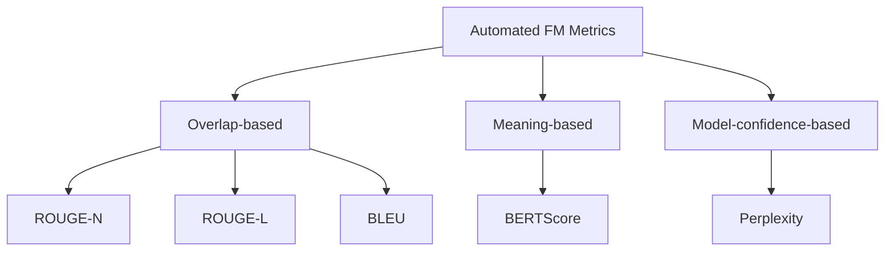
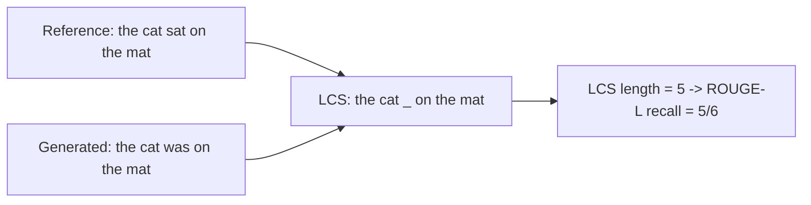
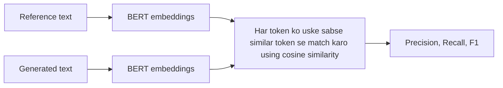
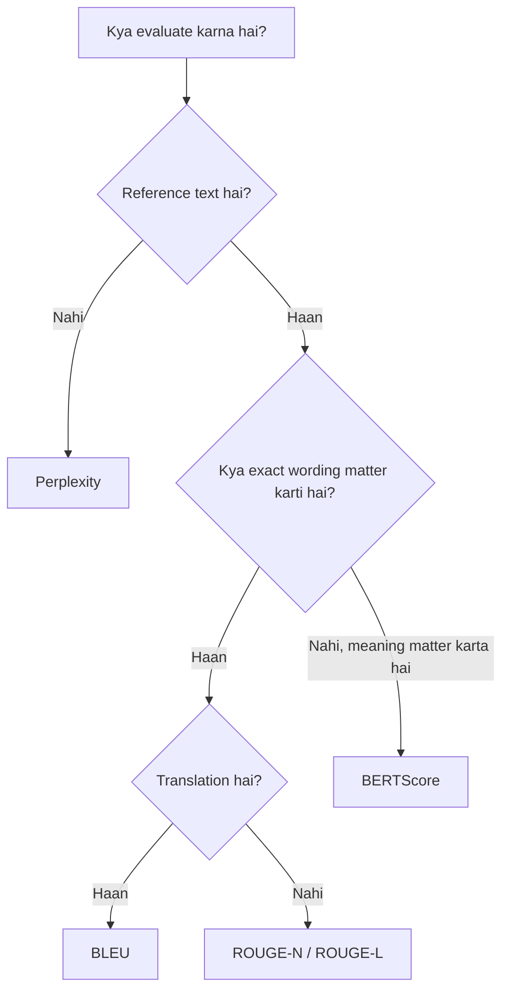

# Foundation Model (FM) Evaluate Karne Ke Liye Automated Metrics

## Core Overview

Automated metrics model ke output ko **bina kisi insaan ke padhe** score karte hain. Hum **generated text** ko **reference text** (yaani "sahi answer") se compare karte hain, ya fir dekhte hain ki model apni predictions mein kitna confident hai. Ye metrics **tez, sasta aur repeatable** hote hain, isliye regression testing, model comparison aur benchmarking ke liye bahut kaam aate hain. Lekin har metric alag cheez measure karta hai, to galat metric chunoge to score misleading aayega.

Slide ke paanch metrics teen families mein aate hain:

| Family | Metrics | Reference text chahiye? | Kaunsa sawaal poochta hai? |
|---|---|---|---|
| Overlap-based | ROUGE-N, ROUGE-L, BLEU | Haan | Kya output ne reference jaise hi words/phrases use kiye? |
| Meaning-based | BERTScore | Haan | Kya output ka **matlab** reference jaisa hai? |
| Confidence-based | Perplexity | Nahi | Model text se kitna "surprised" hai? |

---

## 1. ROUGE: Recall-Oriented Understudy for Gisting Evaluation

### 1.A Ye kya hai

ROUGE check karta hai ki **reference ka kitna content generated text mein aaya**. Ye **recall-oriented** hai, yaani sawaal ye hai: "Model ne wo sab bola jo bolna chahiye tha?" Ye mainly **automatic summarization** ke liye bana tha, aur machine translation mein bhi use hota hai.

### 1.B ROUGE-N (n-gram overlap)

ROUGE-N reference aur generated text ke beech matching **n-grams** (N consecutive words ka group) count karta hai.

- **ROUGE-1** = single words (unigrams)
- **ROUGE-2** = word pairs (bigrams)

**Formulas**

- **Recall** = matching n-grams / **reference** ke total n-grams
- **Precision** = matching n-grams / **generated text** ke total n-grams
- **F1** = 2 x P x R / (P + R)

### 1.C Worked example

- **Reference:** "the cat sat on the mat" (6 words)
- **Generated:** "the cat was on the mat" (6 words)

| Metric | Matches | Recall | Precision | F1 |
|---|---|---|---|---|
| ROUGE-1 | the, cat, on, the, mat = **5** | 5/6 = **0.83** | 5/6 = 0.83 | 0.83 |
| ROUGE-2 | "the cat", "on the", "the mat" = **3** | 3/5 = **0.60** | 3/5 = 0.60 | 0.60 |

Dhyan do ki ROUGE-2 kaafi gir gaya, kyunki ek galat word ("sat" ki jagah "was") **do** bigrams tod deta hai ("cat sat" aur "sat on").

### 1.D ROUGE-L (Longest Common Subsequence)

ROUGE-L **longest common subsequence (LCS)** dhoondhta hai: wo words jo dono texts mein **same order** mein aate hain, lekin ek-dusre ke bilkul bagal mein hone zaroori **nahi** hain. Isse sentence-level structure ko reward milta hai, bina exact adjacent match maange.

Upar ke example mein LCS = "the cat on the mat" = **5 words**, to ROUGE-L recall = 5/6 = **0.83**.

### 1.E Use cases

- **News / document summarization** (kya summary mein key facts hain?)
- **Meeting-notes ya report summarizers**
- **Headline generation**
- **Machine translation** (secondary use)

---

## 2. BLEU: Bilingual Evaluation Understudy

### 2.A Ye kya hai

BLEU measure karta hai ki generated text **ek ya zyada reference texts ke kitna kareeb hai**. Ye originally **machine translation** ke liye bana tha. ROUGE poochta hai "kya tumne reference cover kiya?" (recall), jabki BLEU poochta hai "**jo tumne likha wo sahi hai?**" (**precision**).

### 2.B Kaise kaam karta hai

1. **Modified (clipped) precision** nikalo n-grams ke liye, size **1, 2, 3 aur 4**. "Clipped" ka matlab: koi word reference mein jitni baar aaya hai usse zyada baar credit nahi paa sakta.
2. In sabko **geometric mean** se combine karo.
3. **Brevity Penalty (BP)** se multiply karo, taaki bahut chhote outputs precision score mein cheating na kar sakein.

**Formula:** `BLEU = BP x exp( sum of (1/4) x log p_n )`, jahan n = 1 se 4

### 2.C Worked example 1: clipped precision

- **Reference:** "the cat is on the mat" ("the" 2 baar aaya)
- **Generated:** "the the the the" ("the" 4 baar aaya)

Raw unigram precision 4/4 = 100% hoti. Lekin clipping "the" ko 2 par cap kar deti hai, to precision = 2/4 = **0.50**. Isse model ek common word repeat karke score gaming nahi kar paata.

### 2.D Worked example 2: brevity penalty

- Generated length **c = 4**, reference length **r = 6**
- `BP = exp(1 - r/c) = exp(1 - 6/4) = exp(-0.5)` = **0.61**

Matlab precision perfect bhi ho, to bhi chhota hone ki wajah se score lagbhag 39% kat jata hai. Agar c >= r ho, to BP = 1 (koi penalty nahi).

### 2.E Worked example 3: poora BLEU

Maan lo p1 = 0.8, p2 = 0.6, p3 = 0.5, p4 = 0.4 aur BP = 1:

`BLEU = (0.8 x 0.6 x 0.5 x 0.4)^(1/4) = 0.096^(0.25)` = **0.557** (0-100 scale par lagbhag 55.7)

### 2.F Use cases

- **Machine translation** (English se Hindi, etc.)
- **Code ya text generation jahan ek fixed sahi answer ke kareeb output chahiye**
- **Translation models ko versions ke beech benchmark karna**

---

## 3. BERTScore

### 3.A Ye kya hai

BERTScore word overlap ki jagah **semantic similarity** measure karta hai. Ye ek **pre-trained BERT model** (Bidirectional Encoder Representations from Transformers) use karta hai, jo dono texts ke har token ko **contextual embedding** mein convert karta hai, aur fir tokens ko **cosine similarity** se compare karta hai.

### 3.B Kaise kaam karta hai

- **Recall:** reference ke har token ke liye generated text mein best match dhoondho aur similarities ka average lo.
- **Precision:** wahi process, ulti direction mein.
- **F1:** dono ka harmonic mean.

Cosine similarity -1 se 1 ke beech hoti hai. **1.0** ke paas score ka matlab hai ki meaning bahut kareeb hai.

### 3.C Worked example (illustrative numbers)

- **Reference:** "The weather is cold today."
- **Generated:** "It is freezing outside."

| Metric | Score | Wajah |
|---|---|---|
| ROUGE-1 F1 | lagbhag 0.20 | Sirf "is" exact match hua |
| BLEU | 0 ke kareeb | Almost koi n-gram overlap nahi |
| BERTScore F1 | lagbhag 0.90 (illustrative) | Embedding space mein "cold" aur "freezing" paas hain, "today" aur "outside" bhi |

Yahi iska sabse bada advantage hai: **paraphrases aur synonyms ko punish nahi kiya jaata**.

### 3.D Use cases

- **Abstractive summarization** (model copy karne ki jagah rephrase karta hai)
- **Paraphrase generation**
- **Question answering** jahan wording alag-alag ho sakti hai
- **Chatbot responses** jahan kaafi phrasings valid hain

---

## 4. Perplexity

### 4.A Ye kya hai

Perplexity measure karta hai ki model **agla token kitni achhi tarah predict karta hai**. Isme **reference answer ki zarurat nahi**, sirf model ki apni token probabilities chahiye. **Kam (lower) matlab better.**

**Formula:** `PPL = exp( -(1/N) x sum of log P(token_i | previous tokens) )`

**Intuition:** Perplexity K ka matlab hai ki model average mein utna uncertain hai jaise wo **K barabar-likely tokens** mein se randomly chun raha ho.

### 4.B Worked example

Ek model 4-token wale sentence ko ye probabilities deta hai: 0.5, 0.25, 0.5, 0.25.

- Product = 0.5 x 0.25 x 0.5 x 0.25 = 0.015625
- `PPL = (1 / 0.015625)^(1/4) = 64^(0.25)` = **2.83**

Yaani model har token par lagbhag 3 options ke beech confuse tha. Ek behtar model jo 0.9, 0.8, 0.9, 0.8 deta, uska PPL lagbhag **1.18** hota.

### 4.C Use cases

- **Language models ko compare karna** (same test set aur same tokenizer par)
- **Pre-training ya fine-tuning progress monitor karna** (perplexity girni chahiye)
- **Domain mismatch pakadna** (apni company ke documents par high perplexity matlab model ko domain nahi aata)

---

## 5. Kaunsa Metric Kis Scenario Mein Helpful Hai

| Scenario | Best metric(s) | Kyun | Kahan helpful NAHI hai |
|---|---|---|---|
| News ya reports ki summarization | **ROUGE-N / ROUGE-L** | Check karta hai ki reference ka key content cover hua ya nahi | Abstractive summaries jahan model heavy rephrase karta hai (sahi hone par bhi overlap kam) |
| Machine translation | **BLEU** (aur BERTScore) | N-gram precision (1-4) aur brevity penalty translation ke liye fit hain | Flexible word order wali languages, ya jahan bahut saare valid translations hon |
| Paraphrase ya chatbot answers | **BERTScore** | Synonyms aur context samajhta hai | Jahan exact wording zaroori ho (legal clauses, code, IDs) |
| Open-ended QA jahan phrasing vary kare | **BERTScore** | Semantic match, word match nahi | Similar wording wali factual errors bhi high score le sakti hain |
| Base language models compare karna | **Perplexity** | Reference text ki zarurat nahi | Correctness, helpfulness ya safety **measure nahi** karta |
| Fine-tuning progress track karna | **Perplexity** | Model data fit karta hai to ghatna chahiye | **Alag tokenizers** wale models compare karna (comparable nahi) |
| Creative writing, storytelling | Human evaluation (ye metrics nahi) | Bahut saare valid outputs, koi single reference nahi | **Paaron metrics** yahan weak hain |
| Factual accuracy ya hallucination check | Human review, LLM-as-a-judge, RAG-specific evals | Ye metrics facts verify nahi karte | **Sabhi paanch** fluent lekin galat text ko high score de sakte hain |

### 5.A Yaad rakhne wali limitations

- **ROUGE aur BLEU** valid paraphrases ko punish karte hain aur meaning ignore karte hain.
- **BLEU** mein recall component nahi hai, to wo bata nahi sakta ki zaroori content missing hai ya nahi.
- **BERTScore** underlying BERT model ki quality par depend karta hai aur fluent lekin galat content se dhoka kha sakta hai.
- **Perplexity** batata hai ki text kitna *fluent/predictable* hai, ye nahi ki wo *sahi* ya *useful* hai.
- Sabko ek **achha reference** chahiye (Perplexity ko chhodkar), aur kharab reference se kharab score aata hai.

### 5.B Quick decision guide

---

## 6. Exam-Style Memory Tips (AWS AI Practitioner)

| Metric | Ek line ka memory hook |
|---|---|
| **ROUGE** | **R**ecall, **summaries** |
| **BLEU** | **B**ilingual, **translation**, precision + brevity penalty |
| **BERTScore** | BERT embeddings aur cosine similarity se **semantic** similarity |
| **Perplexity** | Next-token prediction, **lower is better** |

---

## Summary

1. **ROUGE (recall) aur BLEU (precision) word overlap measure karte hain.** Summarization ke liye ROUGE aur translation ke liye BLEU use karo, lekin ye achhe paraphrases ko kam score denge.
2. **BERTScore meaning measure karta hai, exact words nahi.** Jab kaafi phrasings acceptable hon, to teen reference-based metrics mein ye sabse best hai, lekin ye bhi facts verify nahi kar sakta.
3. **Perplexity model ka confidence measure karta hai, output quality nahi.** Language models ko compare aur train karne ke liye ye useful hai, aur ise reference nahi chahiye. Correctness, safety ya creativity ke liye automated metrics ko human ya LLM-based evaluation ke saath combine karo.
